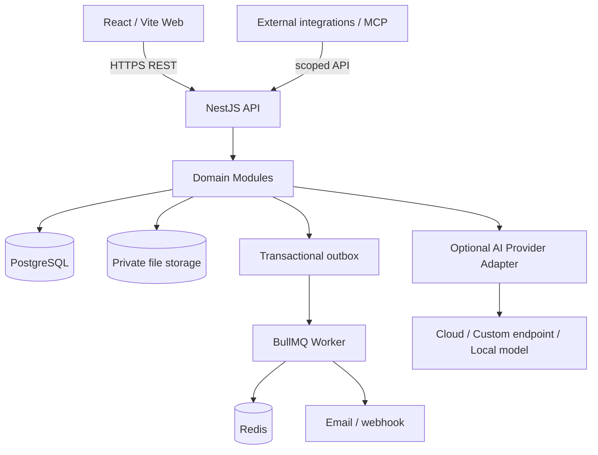

# Technical Architecture

## 1. Architecture style

**Modular monolith**: one NestJS API deployable artifact, one worker process using shared domain packages, React single-page web app, PostgreSQL database, optional Redis/BullMQ, optional AI gateway/service. Business ownership stays with NestJS.



## 2. Monorepo

```text
apps/web                React + Vite web-only UI
apps/api                NestJS HTTP server
apps/worker             Queue and recurring task worker
apps/docs               Versioned documentation (optional)
packages/contracts      OpenAPI generated DTO/types, schemas
packages/api-client     Generated typed HTTP client
packages/db             Drizzle schemas, migrations, DB connection
packages/domain         Pure domain types, policy and transitions
packages/config         Runtime configuration schemas
packages/ui             Web-specific design components
packages/ai             Provider interfaces, implementations, tests
packages/sdk            Public integration client
integrations/mcp        Optional MCP bridge, strictly scoped API auth
infrastructure/compose  Local/dev/prod example Compose stacks
infrastructure/observability
.github/workflows
```

## 3. Domain boundaries

Identity & Workspaces; Assets & Categories; Locations; Custody; Documents; Maintenance; Warranty; Audits; Reporting; Notifications; Integrations; AI Configuration & Execution; Security & Audit Events.
Each module owns public service interfaces and repository operations. Cross-module calls use exported services or domain events; do not directly query another module's tables except through approved read projections.

## 4. Request path

React → generated TypeScript client → authenticated REST controller → authorization guard (workspace and action) → DTO validation → application service → transaction and repository → outbox event → safe response. Avoid tenant ID in body overriding authenticated context.

## 5. Data and consistency

- UUIDv7 or UUID for primary IDs; UTC timestamptz; decimal amounts stored as numeric with currency.
- A user's last-selected workspace is only UI state; server always authorizes selected workspace.
- Every write that changes lifecycle state updates asset and appends immutable event in **one database transaction**.
- Use optimistic version column/compare-and-swap for state transitions.
- Use outbox row in same transaction for webhook/notification jobs; workers must be idempotent.
- Nonblocking reports and large imports become background jobs with status polling.

## 6. API conventions

REST `/api/v1`, OpenAPI generated; cursor or offset pagination with explicit limits; RFC7807-like errors; `Idempotency-Key` for externally retried writes; `ETag`/version on conflict-prone updates. Explicit `workspaceId` in route and check membership each request.

## 7. Auth & integration

Prefer standards-based OIDC for enterprise identity; start with secure first-party session for local deployment. Use session cookies with CSRF protection for browsers. Service accounts/API keys use token scopes, expiry, rotation and hash-at-rest. MCP integration does not bypass application auth.

## 8. AI boundary

Providers are invoked only via `AIProviderRegistry`. Prompting, authorization, retrieval, redaction, token/cost budget, provider routing and structured-result validation are all server-side. Never let a model execute arbitrary SQL or issue HTTP requests on behalf of tenant unless explicitly allowlisted and authorized.

## 9. Configuration rules

Versioned `.env.example` with fail-fast validation; secrets never logged; one configuration mapping per deployment; feature flags for AI, MCP, mail, scheduling, enterprise workflows.

## 10. Architecture fitness tests

Cross-workspace data cannot be read; no controller imports database tables directly; no browser contains provider API keys; no service outside API/worker writes to application tables; all lifecycle changes create history; AI-disabled core passes E2E suite.
