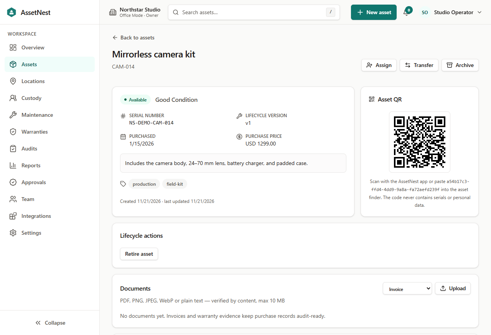

# AssetNest

**Know what you own, where it is, and who has it.**

AssetNest is a self-hosted inventory and equipment manager for households and teams. Track purchases, custody, warranties, and maintenance in the browser. Each workspace has its own inventory, members, and policies. The core app runs on your infrastructure without an AI provider or cloud account.

[Quick start](#quick-start) · [Screenshots](#screenshots) · [Documentation](#documentation) · [Contributing](CONTRIBUTING.md)


_The inventory in a fictional studio workspace, with available, assigned, checked-out, and in-repair equipment._

## What you can do

- **Organize equipment.** Register assets with unique tags, serial numbers, purchase details, and private documents. Group them by category and nested location. Find a record by search or its QR code.
- **Track custody and service.** Assign, transfer, and return equipment. Review its history, set maintenance schedules, and track expiring warranties.
- **Audit and report.** Count inventory by location, record missing or moved items, preview and validate CSV imports, and export asset, warranty, and maintenance reports.
- **Set workspace policies.** Invite members, manage roles, configure audit retention and export expiry, and require human approval for retirement or disposal. Use local sign-in or configure OIDC.

## Quick start

You need Git and Docker with Compose v2. The reference stack includes PostgreSQL 17, Redis 7, the API, the worker, and the web app.

1. **Get the source.**

   ```sh
   git clone https://github.com/MohamedRF/AssetNest.git
   cd AssetNest
   ```

2. **Prepare the configuration.** Follow the [Compose setup guide](infrastructure/compose/README.md#1-prepare-env) using the [environment template](.env.example). Set the database credentials, generate the session secret and encryption key, and use `PUBLIC_APP_URL=http://localhost` for a local install on the default port. Remove both seed credential settings if you want to create the first account in the browser.
3. **Start the stack.** Set `ASSETNEST_CONFIG` to the absolute path of your prepared configuration. Once the stack starts and migrations finish, run the seed command to initialize workspace roles.

   ```sh
   docker compose --env-file "$ASSETNEST_CONFIG" \
     -f infrastructure/compose/compose.yaml --profile app up -d --build

   docker compose --env-file "$ASSETNEST_CONFIG" \
     -f infrastructure/compose/compose.yaml --profile app run --rm migrate \
     pnpm --filter @assetnest/db seed
   ```

4. **Open [localhost](http://localhost).** Create the first account on an empty database or sign in with the [seeded account](docs/INSTALL.md#first-administrator). Create a **Home** or **Office** workspace, then add a location, a category, and your first asset.
5. **Check readiness.** Run `curl -fsS http://localhost/api/v1/health/ready` to confirm that the API can reach PostgreSQL.

For a network-facing deployment, use HTTPS, set `PUBLIC_APP_URL` to the public origin, and back up PostgreSQL together with your private-file volume. [Installation guide](docs/INSTALL.md) · [Operations guide](DEPLOYMENT_OPERATIONS.md)

## Screenshots

<details>
<summary>View an asset record and an inventory audit</summary>

### Asset record

The equipment record shows purchase details, tags, a QR label, private documents, and custody controls.



### Inventory audit

The audit tracks count progress and distinguishes present, missing, and uncounted records.


</details>

## Integrations and optional AI

- **REST and TypeScript SDK.** Use `/api/v1` with a workspace-scoped token created in **Integrations**. A running instance serves Swagger UI at `/api/docs` and OpenAPI JSON at `/api/docs-json`. [API contract](API_SPECIFICATION.md) · [SDK guide](packages/sdk/README.md)
- **Webhooks and MCP.** Enable signed outbound webhooks or the optional MCP endpoint at `/api/v1/mcp`. [Integration examples](examples/README.md)
- **AI workflows.** With `AI_ENABLED=true`, a workspace administrator can configure OpenAI, Anthropic, Gemini, OpenAI-compatible APIs, or local Ollama. Draft asset records from invoices, suggest categories from photos, filter assets in plain language, or ask questions about an asset. Review proposals before applying them. [AI endpoint settings](DEPLOYMENT_OPERATIONS.md#ai-endpoints-in-self-hosted-networks) · [Optional LiteLLM gateway](examples/README.md#optional-litellm-gateway)

## Development

AssetNest uses React, Vite, and Tailwind CSS for the [web app](apps/web), NestJS for the [API](apps/api), PostgreSQL and Drizzle for [data access](packages/db), and Redis and BullMQ for the [worker](apps/worker).

Use Node.js 22.12 or later and pnpm 10.34.9. Follow the [source setup instructions](docs/INSTALL.md#option-a--development-source--infra-containers) to start dependencies, configure the shell, and run migrations. The web app listens on port 5173 and the API on port 3000 by default.

```sh
pnpm lint
pnpm typecheck
pnpm test --concurrency=1
pnpm build
pnpm format:check
pnpm sdk:check
```

## Documentation

- **Deploy and maintain** · [Installation](docs/INSTALL.md) · [Operations and backups](DEPLOYMENT_OPERATIONS.md) · [Upgrades and rollback](docs/UPGRADE.md)
- **Try and verify** · [Demo walkthrough](docs/DEMO.md) · [Release process](docs/RELEASE.md) · [Changelog](CHANGELOG.md)
- **Contribute or get help** · [Contributing and bug reports](CONTRIBUTING.md) · [Private vulnerability reporting](SECURITY.md)

## License

AssetNest is available under the [MIT License](LICENSE).
