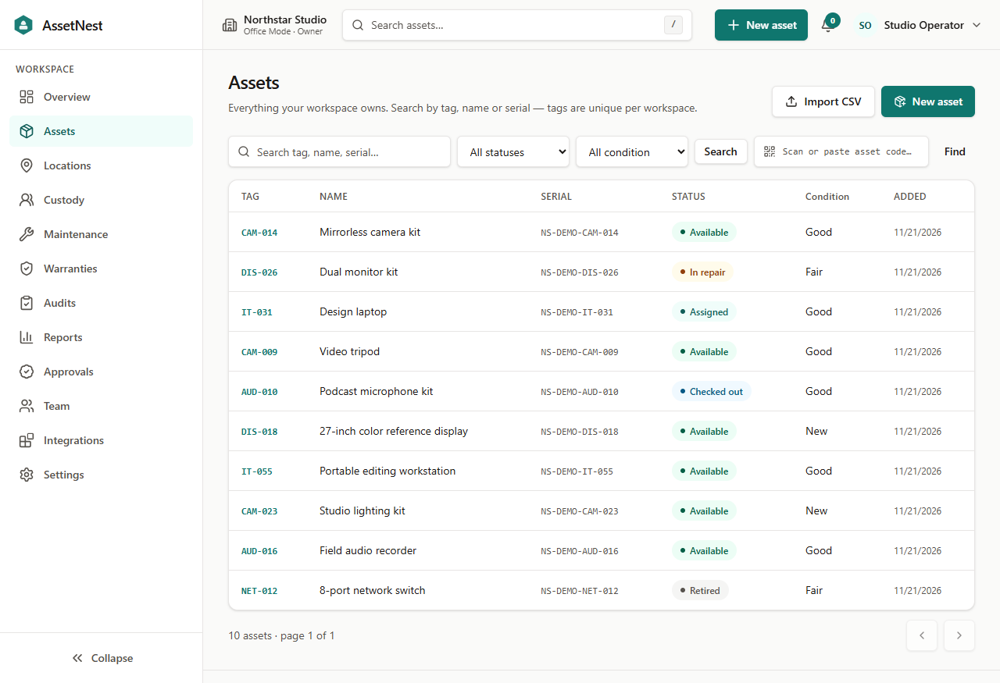

<h1 align="center">AssetNest</h1>

<p align="center"><strong>Self-hosted inventory for the equipment you own, lend, and maintain.</strong></p>

<p align="center">
  <a href="#quick-start">Quick start</a> ·
  <a href="#product-tour">Product tour</a> ·
  <a href="docs/INSTALL.md">Installation</a> ·
  <a href="CONTRIBUTING.md">Contribute</a>
</p>

<p align="center">
  <a href="https://github.com/MohamedRF/AssetNest/actions/workflows/ci.yml"></a>
  <a href="LICENSE"></a>
</p>

<p align="center">
  <a href="docs/screenshots/inventory.png"></a>
</p>

Keep equipment records, purchase details, and documents in one place. Label assets, track who has them, and reconcile what’s physically on the shelf. AssetNest runs in your browser on infrastructure you control. Core inventory works without an AI key or a cloud account.

## Quick start

You need Git and Docker with Compose v2. The reference stack includes the web app, API, worker, PostgreSQL, and Redis.

1. Clone the repository.

   ```sh
   git clone https://github.com/MohamedRF/AssetNest.git
   cd AssetNest
   ```

2. Copy `.env.example` to `.env` and follow the [configuration guide](infrastructure/compose/README.md#1-prepare-env) to generate secrets and set the local address. For the demo, set both seed credential variables.
3. Start the stack and initialize workspace roles. With both seed credentials configured, the second command also creates your demo account and workspaces.

   ```sh
   docker compose --env-file .env -f infrastructure/compose/compose.yaml --profile app up -d --build
   docker compose --env-file .env -f infrastructure/compose/compose.yaml --profile app run --rm migrate pnpm --filter @assetnest/db seed
   ```

4. Open [http://127.0.0.1:8080](http://127.0.0.1:8080) and sign in with the credentials you set. For a fresh workspace, follow the [setup without demo data](infrastructure/compose/README.md#start-without-demo-workspaces).

The [Compose guide](infrastructure/compose/README.md) covers PowerShell and Bash, readiness checks, and HTTPS. For an instance people will access from phones and other devices, use a reachable HTTPS address and set it as `PUBLIC_APP_URL`.

## Product tour

| Asset record                                                                                                                                                 | Inventory audit                                                                                                                                      |
| ------------------------------------------------------------------------------------------------------------------------------------------------------------ | ---------------------------------------------------------------------------------------------------------------------------------------------------- |
| [](docs/screenshots/asset-details.png) | [](docs/screenshots/inventory-audit.png) |

- **Build the inventory.** Add and edit assets with unique tags, serial numbers, locations, and private documents. Record purchase prices in your chosen currency, or import an existing inventory with a CSV preview and validation.
- **Label and find equipment.** Print QR codes from 20–100 mm or select up to 100 assets for a batch. A signed-in phone can scan from **Assets → Scan QR** over HTTPS. With report access and workspace exports enabled, download a ZIP of SVGs and matching asset details.
- **Track custody and upkeep.** Assign, return, and transfer equipment while keeping its history. Record warranty dates, maintenance schedules, and service costs.
- **Count what’s on site.** Open a location-based audit, mark assets present, missing, or moved, and export inventory reports as CSV.

## Workspace controls and integrations

- **Access and approvals.** Invite members with workspace roles, configure optional OIDC sign-in, and set audit retention and export policies. Require approval for retirement or disposal where your workflow calls for it. [Operations guide](DEPLOYMENT_OPERATIONS.md)
- **API and automation.** Use workspace-scoped API tokens, the TypeScript SDK, signed webhooks, or the optional MCP endpoint. A running instance serves Swagger UI at `/api/docs` and OpenAPI JSON at `/api/docs-json`. [API specification](API_SPECIFICATION.md) · [SDK](packages/sdk/README.md) · [Examples](examples/README.md)
- **Optional AI.** Configure OpenAI, Anthropic, Gemini, an OpenAI-compatible endpoint, or local Ollama. Use it to draft assets from invoices, suggest categories from photos, and search in plain language. Review proposed asset changes before applying them. [Provider setup](DEPLOYMENT_OPERATIONS.md#ai-endpoints-in-self-hosted-networks)

## Development

The web app uses React, Vite, and Tailwind CSS. The NestJS API stores data in PostgreSQL through Drizzle, and the worker uses Redis and BullMQ.

Use Node.js 22.12 or later and pnpm 10.34.9. Follow the [source setup guide](docs/INSTALL.md#option-a--development-source--infra-containers) to configure the environment, run migrations, and start the web app and API.

```sh
pnpm lint
pnpm typecheck
pnpm test --concurrency=1
pnpm build
pnpm format:check
pnpm sdk:check
```

## Documentation

| Task                 | Guides                                                                                                                                                                                      |
| -------------------- | ------------------------------------------------------------------------------------------------------------------------------------------------------------------------------------------- |
| Install and maintain | [Installation options](docs/INSTALL.md) · [Docker Compose](infrastructure/compose/README.md) · [Operations and backups](DEPLOYMENT_OPERATIONS.md) · [Upgrade and rollback](docs/UPGRADE.md) |
| Try the product      | [Demo walkthrough](docs/DEMO.md)                                                                                                                                                            |
| Follow releases      | [Changelog](CHANGELOG.md) · [Release process](docs/RELEASE.md)                                                                                                                              |
| Get involved         | [Contributing and bug reports](CONTRIBUTING.md) · [Private vulnerability reporting](SECURITY.md)                                                                                            |

## License

AssetNest is available under the [MIT License](LICENSE).
