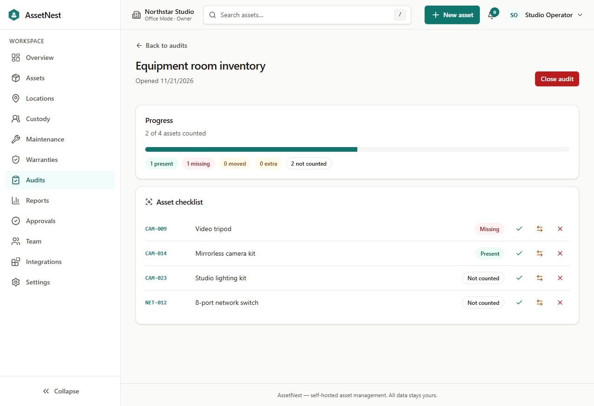

# AssetNest

**Self-hosted equipment and inventory management for households and teams.**

Track equipment from purchase through assignment, maintenance, and retirement. Use QR labels to find records, reconcile physical inventory, and keep the history of each asset in its workspace. AssetNest runs in your browser on infrastructure you control. The core app works without an AI provider or cloud account.

[Quick start](#quick-start) · [Docker Compose setup](infrastructure/compose/README.md) · [Product tour](#product-tour) · [Development](#development) · [Contributing](CONTRIBUTING.md)


_The inventory in a fictional studio workspace, with available, assigned, checked-out, and in-repair equipment._

## Quick start

You need Git and Docker with Compose v2. The reference stack includes PostgreSQL 17, Redis 7, the API, the worker, and the web app.

1. **Get the source.**

   ```sh
   git clone https://github.com/MohamedRF/AssetNest.git
   cd AssetNest
   ```

2. **Prepare the configuration.** Follow the [Docker Compose setup guide](infrastructure/compose/README.md#1-prepare-env) using the [environment template](.env.example). For a local evaluation, the guide uses port 8080 and seeds an account with Home and Office demo workspaces.
3. **Start the stack.** Set `ASSETNEST_CONFIG` to the absolute path of the configuration you prepared. Run these commands from the repository root after Docker has started.

   ```sh
   docker compose --env-file "$ASSETNEST_CONFIG" -f infrastructure/compose/compose.yaml --profile app up -d --build

   docker compose --env-file "$ASSETNEST_CONFIG" -f infrastructure/compose/compose.yaml --profile app run --rm migrate pnpm --filter @assetnest/db seed
   ```

4. **Sign in.** Open [http://127.0.0.1:8080](http://127.0.0.1:8080) with the sample local configuration. Use your seeded credentials, or follow the guide to [create the first account without demo data](infrastructure/compose/README.md#start-without-demo-workspaces).

The [Docker Compose setup guide](infrastructure/compose/README.md) covers Bash and PowerShell configuration, readiness checks, logs, and safe shutdown. For a network-facing deployment, see [operations and backups](DEPLOYMENT_OPERATIONS.md).

## Product tour

1. **Register equipment.** Open **Assets → New asset**. Give the equipment a unique tag, such as `CAM-014`, and link a location. Use **Import CSV** to preview and validate a larger inventory before importing it.
2. **Find and assign it.** Search for its tag, name, or serial number. Open the asset record to see the QR label, review purchase details, attach a document, or use **Assign** and **Transfer**.
3. **Reconcile the room.** Open **Audits → New audit**, select a location, and record which items are present, missing, or moved. Use **Reports** to export the inventory as CSV.

| Asset record                                                                                                      | Physical inventory audit                                                                                              |
| ----------------------------------------------------------------------------------------------------------------- | --------------------------------------------------------------------------------------------------------------------- |
|  |  |
| [Open full-size asset record](docs/screenshots/asset-details.png)                                                 | [Open full-size audit](docs/screenshots/inventory-audit.png)                                                          |

AssetNest also tracks maintenance schedules, warranties, and lifecycle history. Workspace administrators can invite members, configure OIDC, set retention and export policies, and require human approval before retirement or disposal.

## Integrations and optional AI

- **REST and TypeScript SDK.** Use `/api/v1` with a workspace-scoped token created in **Integrations**. A running instance serves Swagger UI at `/api/docs` and OpenAPI JSON at `/api/docs-json`. [API contract](API_SPECIFICATION.md) · [SDK guide](packages/sdk/README.md)
- **Webhooks and MCP.** Enable signed outbound webhooks or the optional MCP endpoint at `/api/v1/mcp`. [Integration examples](examples/README.md)
- **AI workflows.** With `AI_ENABLED=true`, a workspace administrator can configure OpenAI, Anthropic, Gemini, OpenAI-compatible APIs, or local Ollama. Draft asset records from invoices, suggest categories from photos, filter assets in plain language, or ask questions about an asset. Review proposals before applying them. [AI endpoint settings](DEPLOYMENT_OPERATIONS.md#ai-endpoints-in-self-hosted-networks) · [Optional LiteLLM gateway](examples/README.md#optional-litellm-gateway)

## Development

AssetNest uses React, Vite, and Tailwind CSS for the [web app](apps/web), NestJS for the [API](apps/api), PostgreSQL and Drizzle for [data access](packages/db), and Redis and BullMQ for the [worker](apps/worker).

Use Node.js 22.12 or later and pnpm 10.34.9. Follow the [source setup instructions](docs/INSTALL.md#option-a--development-source--infra-containers) to start dependencies, configure the shell, and run migrations. The web app listens on port 5173 and the API on port 3000 by default.

```sh
pnpm lint
pnpm typecheck
pnpm test --concurrency=1
pnpm build
pnpm format:check
pnpm sdk:check
```

## Documentation

- **Deploy and maintain** · [Docker Compose](infrastructure/compose/README.md) · [Installation options](docs/INSTALL.md) · [Operations and backups](DEPLOYMENT_OPERATIONS.md) · [Upgrades and rollback](docs/UPGRADE.md)
- **Try and verify** · [Demo walkthrough](docs/DEMO.md) · [Release process](docs/RELEASE.md) · [Changelog](CHANGELOG.md)
- **Contribute or get help** · [Contributing and bug reports](CONTRIBUTING.md) · [Private vulnerability reporting](SECURITY.md)

## License

AssetNest is available under the [MIT License](LICENSE).
