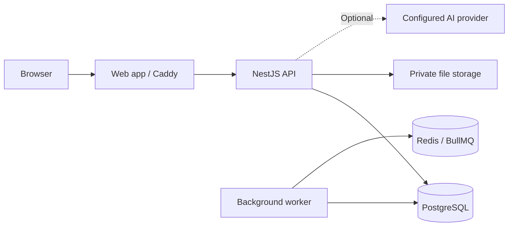

# Architecture and repository map

AssetNest is a TypeScript monorepo managed with pnpm workspaces and Turborepo.
The reference deployment runs a browser app, an HTTP API, a background worker, PostgreSQL, and Redis.

## Runtime components

The React web app uses the API for data and authentication. In the Compose deployment, Caddy serves
static assets and proxies API requests. The API applies workspace permissions and business rules,
and PostgreSQL stores persistent application data. The worker processes outbox events and delivers
notifications and webhooks using Redis/BullMQ. Private file storage is configured separately from the database.

AI providers and OIDC sign-in are optional integrations. Core inventory remains usable with AI disabled.
See the [operations guide](../DEPLOYMENT_OPERATIONS.md) for configuration and deployment boundaries.

## Repository map

| Path                     | Responsibility                                                       |
| ------------------------ | -------------------------------------------------------------------- |
| `apps/web`               | React, Vite, and Tailwind CSS browser application                    |
| `apps/api`               | NestJS HTTP API, authentication, authorization, and feature services |
| `apps/worker`            | Outbox relay, email delivery, and webhook processing                 |
| `packages/domain`        | Shared domain concepts and business rules                            |
| `packages/contracts`     | Shared request/response contracts and validation                     |
| `packages/db`            | Drizzle schema, database access, migrations, and seed tooling        |
| `packages/config`        | Environment configuration and validation                             |
| `packages/ai`            | Optional AI provider adapters                                        |
| `packages/sdk`           | TypeScript API client and generated OpenAPI types                    |
| `infrastructure/compose` | Reference Dockerfiles, Compose stack, and proxy configuration        |
| `infrastructure/scripts` | Backup, restore, and administrative scripts                          |
| `scripts`                | SDK generation, release checks, demo, and installation tools         |
| `examples`               | Integration scripts and n8n workflows                                |
| `.github`                | CI/release workflows, Dependabot, and contribution templates         |

## Contracts and data changes

- The server enforces workspace isolation; client-supplied workspace IDs do not establish authorization.
- API contract changes should update the OpenAPI output and SDK types. Use `pnpm sdk:check` to detect drift.
- Schema changes use additive migrations. Do not edit migrations already applied to an instance.
- Credentials and deployment configuration belong in environment variables, outside Git.

## Verification

The CI workflow runs lint, SDK drift checks, type checking, tests, builds, formatting, and a production
dependency audit. Separate jobs apply migrations to PostgreSQL 17 and validate Compose plus all three
Docker image builds. PGlite supports local database tests; real PostgreSQL migration checks provide
additional coverage.

Changes reach `master` through pull requests with the required CI checks passing against the current branch.
For local commands and review expectations, see [CONTRIBUTING.md](../CONTRIBUTING.md).
